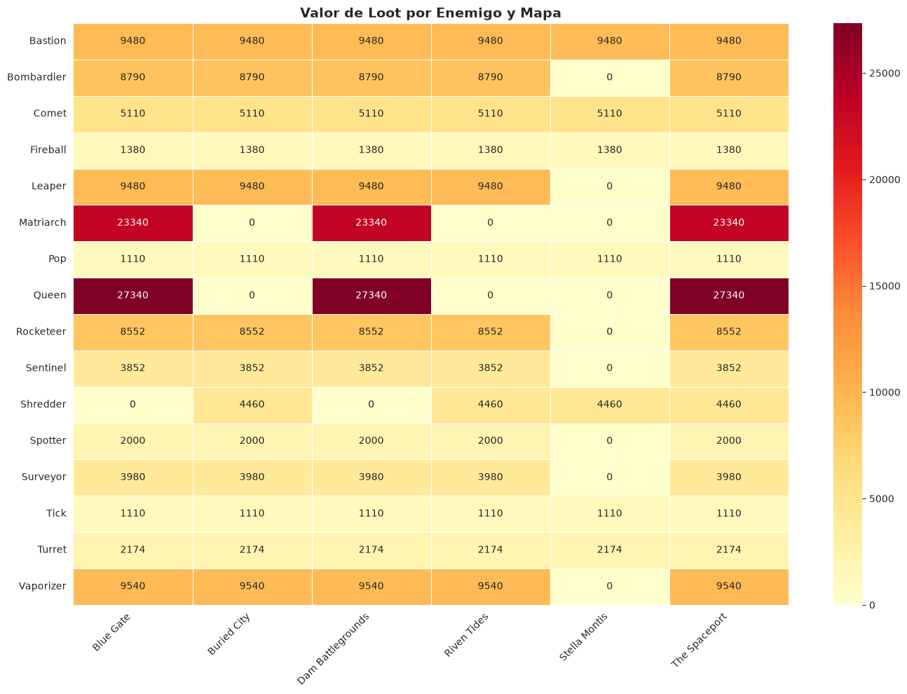
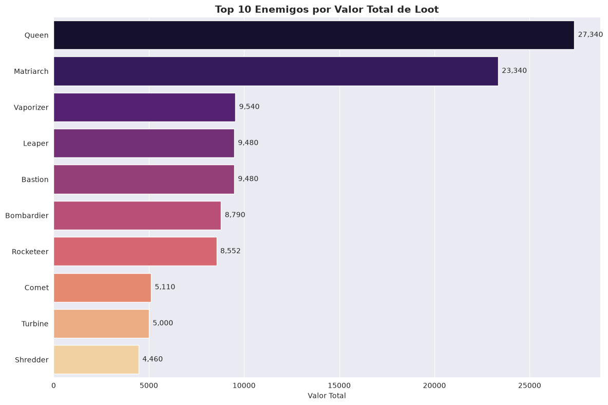
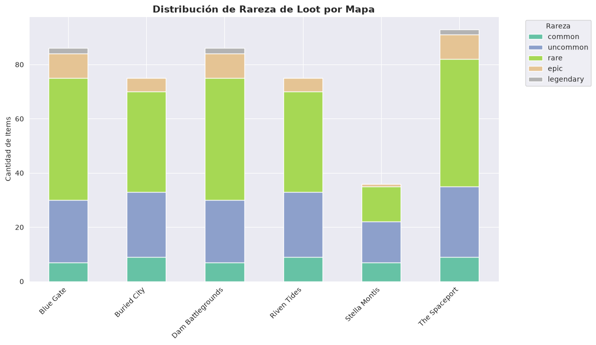

# Análisis de Loot de ARC Raiders

[English](README.md) · **Español**


Análisis exploratorio de datos del videojuego **ARC Raiders**: ¿qué enemigos sueltan el loot más valioso y dónde encontrarlos?

Los datos son un dataset público de Kaggle donde las relaciones (tablas de drops, mapas, componentes de reciclaje) vienen como **cadenas JSON anidadas dentro de columnas CSV**. Este proyecto las aplana en un **esquema SQLite normalizado** y responde las preguntas con **JOINs de SQL y gráficas**.



## Hallazgos principales

- **Queen** es la mejor fuente de loot: **27,340** de valor total en 11 drops. Le sigue **Matriarch** con **23,340** en 7 drops.
- Ambos solo aparecen en **Blue Gate**, **Dam Battlegrounds** y **The Spaceport**.
- **Stella Montis** es el mapa más pobre en loot de alto valor: 7 tipos de enemigo (contra 14–16 en los demás) y solo **1** drop épico o legendario (contra 11 en Blue Gate, Dam Battlegrounds y The Spaceport).
- 5 enemigos no tienen mapa asociado. 4 son drones de patrulla (Firefly, Hornet, Snitch, Wasp) que tampoco tienen coordenadas fijas. No es un error de los datos: recorren todo el mapa. El quinto, Turbine, tiene coordenadas pero no lista de mapas.

| Top enemigos por valor de loot | Distribución de rareza por mapa |
|---|---|
|  |  |

## Pipeline

```
CSVs de Kaggle (JSON anidado)  ──►  src/load_to_sqlite.py  ──►  SQLite (7 tablas)  ──►  notebooks (SQL + seaborn)
```

| Tabla | Filas | Descripción |
|---|---|---|
| `enemies` | 21 | Catálogo de enemigos ARC |
| `enemy_drops` | 116 | Enemigo → items que suelta (aplanado de `dropTable`) |
| `enemy_maps` | 81 | Tabla puente enemigo ↔ mapa |
| `maps` | 6 | Catálogo único de mapas (de enemigos y misiones) |
| `items` | 500 | Catálogo de items: rareza, valor, peso |
| `quests` | 98 | Catálogo de misiones |
| `quest_maps` | 199 | Tabla puente misión ↔ mapa |

## Notebooks

1. [`00_data_exploration.ipynb`](notebooks/00_data_exploration.ipynb): perfilado de datos, análisis de nulos, parseo de columnas JSON y relaciones de reciclaje (508 filas).
2. [`01_loot_analysis.ipynb`](notebooks/01_loot_analysis.ipynb): consultas SQL sobre la base normalizada, 5 gráficas (barras, barras apiladas, dispersión con burbujas, mapa de calor) y conclusiones.

## Cómo correrlo

```bash
git clone https://github.com/angel-valencia-c/arc-raiders-loot-analysis.git
cd arc-raiders-loot-analysis
python -m venv .venv && source .venv/bin/activate
pip install -r requirements.txt -r requirements-dev.txt

# 1. Descarga el dataset de Kaggle y pon los 3 CSV en data/raw/
#    https://www.kaggle.com/datasets/ektarr/arc-raiders-database
#    (arc_enemies.csv, items.csv, quests.csv)

# 2. Construye la base de datos SQLite
python -m src.load_to_sqlite

# 3. Abre los notebooks
jupyter notebook notebooks/
```

## Pruebas

```bash
pytest
```

7 pruebas unitarias cubren el parseo de JSON (valores válidos, vacíos y mal formados), cada paso de normalización y una ejecución completa que construye la base desde CSV sintéticos. GitHub Actions las corre en cada push.

## Estructura

```
├── src/load_to_sqlite.py      # ETL: CSV + JSON anidado → SQLite normalizado
├── notebooks/                 # exploración y análisis
├── tests/                     # pruebas pytest (datos sintéticos)
├── figures/                   # gráficas exportadas de los notebooks
└── data/                      # no se versiona: raw/ (CSV de Kaggle), processed/ (SQLite)
```

## Datos y créditos

- Dataset: [ARC Raiders Database](https://www.kaggle.com/datasets/ektarr/arc-raiders-database) de *ektarr* en Kaggle, construido a partir de la API comunitaria ARDB. Los datos **no se redistribuyen** en este repositorio; descárgalos de Kaggle.
- *ARC Raiders* y todos los nombres del juego pertenecen a Embark Studios. Este es un proyecto de análisis independiente y sin fines comerciales; el banner y las gráficas son trabajo original generado a partir de los datos.
- Desarrollado con asistentes de programación con IA. Yo dirigí el análisis y validé cada resultado contra los datos.
