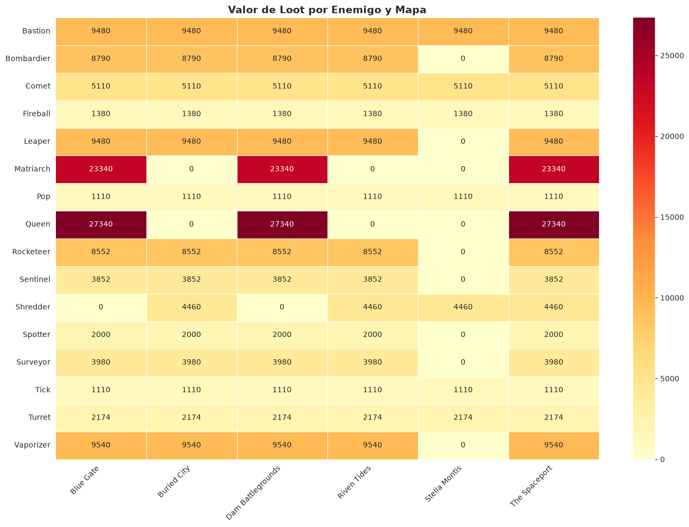
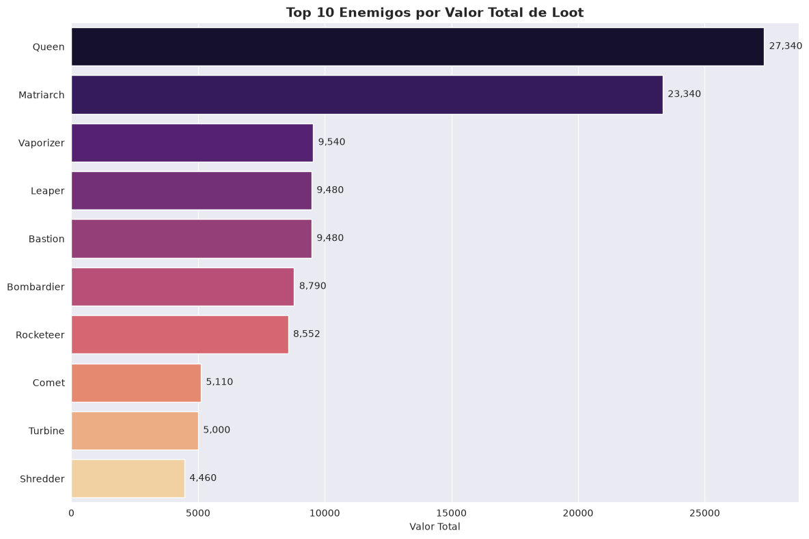
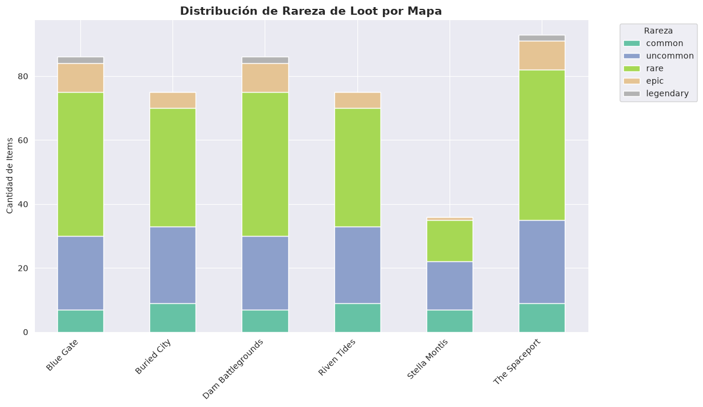

# ARC Raiders Loot Analysis

**English** · [Español](README.es.md)


Exploratory data analysis of the video game **ARC Raiders**: which enemies drop the most valuable loot, and where to find them?

The raw data is a public Kaggle dataset where relationships (drop tables, maps, recycling components) are stored as **nested JSON strings inside CSV columns**. This project flattens them into a **normalized SQLite schema** and answers the questions with **SQL joins and charts**.



## Key findings

- **Queen** is the best loot source: **27,340** total value across 11 item drops. **Matriarch** comes next with **23,340** across 7 drops.
- Both only appear on **Blue Gate**, **Dam Battlegrounds** and **The Spaceport**.
- **Stella Montis** is the poorest map for high-value loot: 7 enemy types (vs. 14–16 elsewhere) and only **1** epic/legendary drop (vs. 11 on Blue Gate, Dam Battlegrounds and The Spaceport).
- 5 enemies have no map link. 4 of them are patrol drones (Firefly, Hornet, Snitch, Wasp) that also lack fixed coordinates. This is not a data error: they roam the whole map. The fifth, Turbine, has coordinates but no map list.

| Top enemies by loot value | Rarity distribution by map |
|---|---|
|  |  |

> Chart labels and notebook comments are in Spanish, the language of the original analysis.

## Pipeline

```
Kaggle CSVs (nested JSON)  ──►  src/load_to_sqlite.py  ──►  SQLite (7 tables)  ──►  notebooks (SQL + seaborn)
```

| Table | Rows | Description |
|---|---|---|
| `enemies` | 21 | ARC enemy catalog |
| `enemy_drops` | 116 | Enemy → item drops (flattened from `dropTable`) |
| `enemy_maps` | 81 | Enemy ↔ map bridge table |
| `maps` | 6 | Unique map catalog (from enemies and quests) |
| `items` | 500 | Item catalog: rarity, value, weight |
| `quests` | 98 | Quest catalog |
| `quest_maps` | 199 | Quest ↔ map bridge table |

## Notebooks

1. [`00_data_exploration.ipynb`](notebooks/00_data_exploration.ipynb): data profiling, null analysis, parsing JSON columns, item recycling relations (508 rows).
2. [`01_loot_analysis.ipynb`](notebooks/01_loot_analysis.ipynb): SQL queries over the normalized database, plus 5 charts (bar, stacked bar, bubble scatter, heatmap) and conclusions.

## How to run

```bash
git clone https://github.com/angel-valencia-c/arc-raiders-loot-analysis.git
cd arc-raiders-loot-analysis
python -m venv .venv && source .venv/bin/activate
pip install -r requirements.txt -r requirements-dev.txt

# 1. Download the dataset from Kaggle and put the 3 CSVs in data/raw/
#    https://www.kaggle.com/datasets/ektarr/arc-raiders-database
#    (arc_enemies.csv, items.csv, quests.csv)

# 2. Build the SQLite database
python -m src.load_to_sqlite

# 3. Open the notebooks
jupyter notebook notebooks/
```

## Tests

```bash
pytest
```

7 unit tests cover JSON parsing (valid, empty and malformed values), each normalization step and an end-to-end run that builds the database from synthetic CSVs. GitHub Actions runs them on every push.

## Project structure

```
├── src/load_to_sqlite.py      # ETL: CSV + nested JSON → normalized SQLite
├── notebooks/                 # exploration and analysis
├── tests/                     # pytest unit tests (synthetic data)
├── figures/                   # charts exported from the notebooks
└── data/                      # not committed: raw/ (Kaggle CSVs), processed/ (SQLite)
```

## Data and credits

- Dataset: [ARC Raiders Database](https://www.kaggle.com/datasets/ektarr/arc-raiders-database) by *ektarr* on Kaggle, built from the community ARDB API. The data is **not redistributed** in this repository; download it from Kaggle.
- *ARC Raiders* and all game names belong to Embark Studios. This is an independent, non-commercial analysis project; the banner and charts are original work generated from the data.
- Developed with AI coding assistants. I directed the analysis and validated every result against the data.
